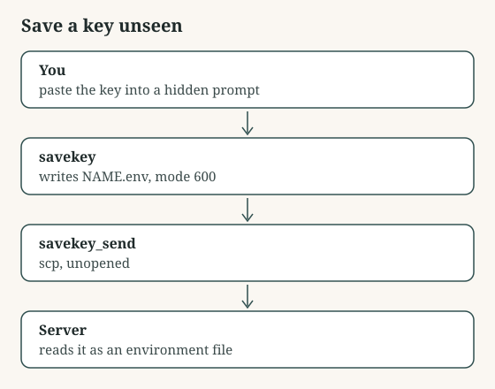

# Save a key unseen

A hidden-input shell function that writes an API key to a locked file, then copies that file to a server without it being opened; the key never passes through chat, the screen or shell history.

## Use it

1. Source savekey.sh in your shell profile.
2. Run: savekey STRIPE_API_KEY, and paste the key when asked (nothing shows).
3. Run: savekey_send STRIPE_API_KEY you@server /etc/myapp/ to copy it up unopened.
4. On the server, load it as an environment file (systemd EnvironmentFile=, or set -a; . file; set +a).

Files: savekey.sh.

## Assumptions

- A Mac or Linux shell (bash or zsh).
- scp access to the server for the copy step.

## Limitations

- The key is stored in plain text on disk, protected by file permissions only; use a secrets manager where you have one.
- Anyone with your user account can read the file.

## Validation

- `bash test_savekey.sh`: passes

## What it touches

- Data flows: copies one file to a server you name (scp); talks to the network
- Permissions: creates folders; reads environment variables; sets file permissions; writes files
- API costs: none: no paid API is called

Shared as is, without warranty. Read it before you run it.
