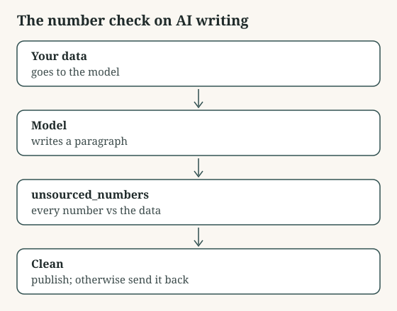

# The number check on AI writing

Refuses an AI-written paragraph that contains any number not in its source data, allowing the rounding people actually do.

## Use it

1. Copy numbercheck.py next to the code that calls your model.
2. Pass the model's text and the exact data you gave it to unsourced_numbers().
3. If the list is not empty, reject the text or send it back with the list.

Files: numbercheck.py.

## Assumptions

- The source data is the same data the model was given.
- Python 3.8 or later, standard library only.

## Limitations

- Numbers written as words (twelve) are not checked.
- It proves a number came from the source, not that it was used in the right place: 412 orders written as 412 refunds passes.

## Validation

- `python3 test_numbercheck.py`: passes

## What it touches

- Data flows: none: it reads only what you pass it
- Permissions: none beyond reading its arguments
- API costs: none: no paid API is called

Shared as is, without warranty. Read it before you run it.
