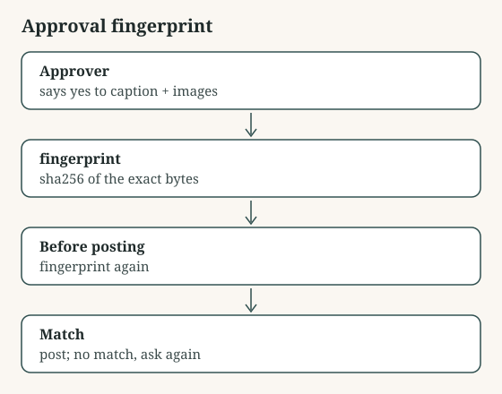

# Approval fingerprint

Ties an approval to a fingerprint of the exact caption and image bytes; change one pixel and the approval no longer matches.

## Use it

1. When someone approves, store fingerprint(caption, files) with their name.
2. Right before publishing, call still_approved() with what is about to go out.
3. If it is False, the thing changed after sign-off: ask again.

Files: fingerprint.py.

## Assumptions

- You keep the approval record somewhere your publisher can read.
- Python 3.8 or later, standard library only.

## Limitations

- It detects change, not intent: re-saving an identical-looking image with new compression counts as a change.
- File order matters; pass files in a fixed order.

## Validation

- `python3 test_fingerprint.py`: passes

## What it touches

- Data flows: none: it reads only what you pass it
- Permissions: none beyond reading its arguments
- API costs: none: no paid API is called

Shared as is, without warranty. Read it before you run it.
